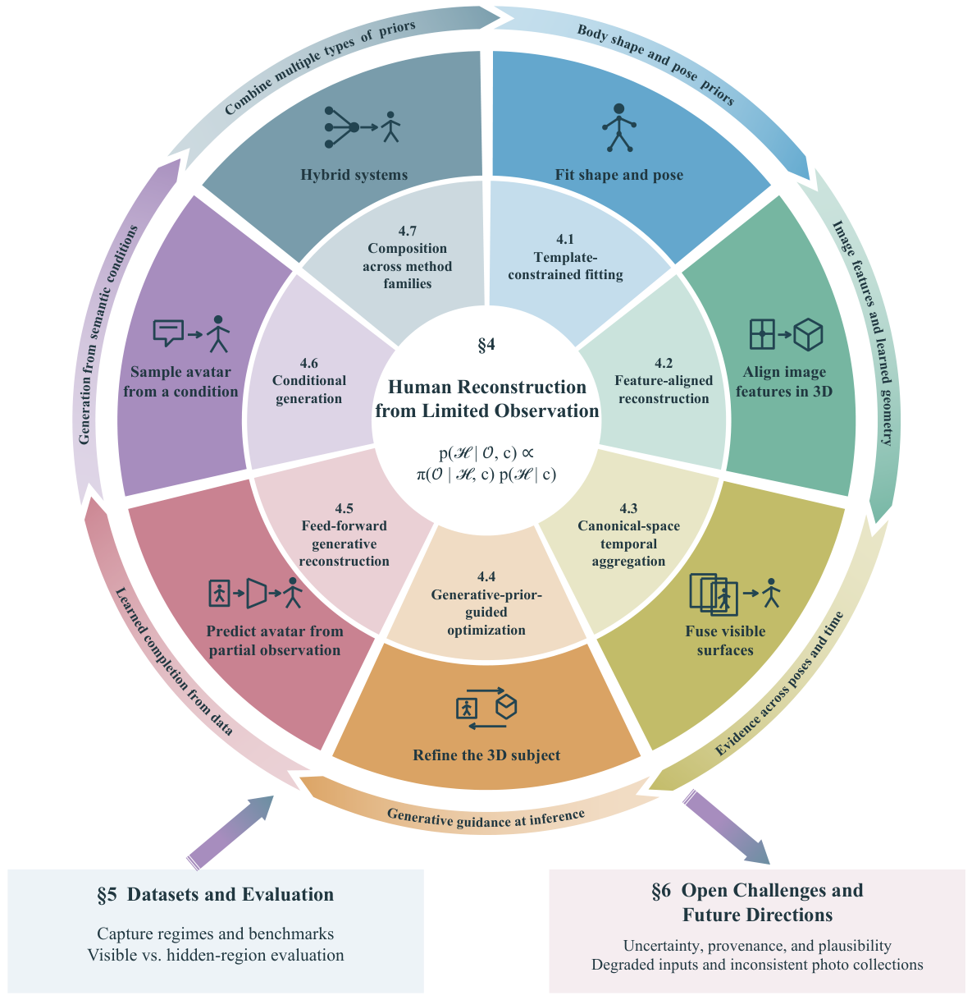

<h1 align="center">Limited-Observation Human Reconstruction</h1>
<p align="center"><strong>From incomplete evidence to complete 3D humans.</strong></p>
<p align="center">A companion resource for<br><em>Reconstructing Complete 3D Humans from Limited Observations: A Survey</em></p>
<p align="center"><a href="paper/survey-draft.pdf">Survey draft</a> &middot; <a href="resources/taxonomy.md">Taxonomy</a> &middot; <a href="resources/papers.md">Paper index</a> &middot; <a href="data/references.bib">BibTeX</a> &middot; <a href="CONTRIBUTING.md">Contribute</a></p>

<p align="center"></p>

**Jinlong Fan · Jing Zhang · Mingming Gong · Yuxiang Yang · Dacheng Tao**

How can a system reconstruct a particular person when the available images do not reveal the whole person? This collection separates **what is missing** from **how it is compensated**. It connects evidence-based reconstruction with data-driven generation across full-body, head, and hand reconstruction.

The paper is the conceptual guide; this repository adds searchable inventories, reusable resources, and practical evaluation guidance. The accompanying PDF follows the author-finalized v2 manuscript.

**Repository:** [loong8888/Limited-Observation-Human-Reconstruction](https://github.com/loong8888/Limited-Observation-Human-Reconstruction) · **arXiv:** `ARXIV_ID_TO_BE_ADDED` (replace when assigned).

## Start Here

<p> <strong>Read the evidence. Trace the prior. Inspect the completion.</strong></p>

| Explore the literature | Build and evaluate |
| :--- | :--- |
| [Six method families](resources/taxonomy.md) | [Datasets and capture resources](resources/datasets.md) |
| [All 243 bibliography records](resources/papers.md) | [Models, rendering, and geometry tools](resources/tools.md) |
| [Reading routes by observation regime](resources/reading-routes.md) | [Evaluation and reproducibility checklist](resources/evaluation.md) |
| [11 official implementation entry points](resources/implementations.md) | [Publication and maintenance guide](MAINTAINING.md) |
| [Hybrid systems and prior interfaces](resources/composition.md) | [Open problems and research opportunities](resources/research-directions.md) |

A filterable, offline-capable browser is included at [homepage/index.html](homepage/index.html). Open it locally, or publish this repository with GitHub Pages using the instructions in [MAINTAINING.md](MAINTAINING.md).

## Four Observation Axes

| Axis | Rich evidence | Limited evidence |
| :--- | :--- | :--- |
| Spatial completeness | Dense calibrated views | Sparse views, a single image, a truncated crop |
| Temporal completeness | Diverse motion sequences | Short clips or a single pose |
| Observation quality | Clean, visible observations | Occlusion, blur, noise, archival damage |
| Observation coherence | Synchronized, consistent capture | Photos spanning cameras, time, outfits, and appearance |

The axes may interact. Text-only generation is a useful boundary case, not evidence of a captured subject.

## Six Method Families

<table><tr><td align="center"><a href="resources/template.md"><br>Template fitting</a></td><td align="center"><a href="resources/feature.md"><br>Feature alignment</a></td><td align="center"><a href="resources/temporal.md"><br>Temporal aggregation</a></td></tr><tr><td align="center"><a href="resources/priorguided.md"><br>Prior-guided</a></td><td align="center"><a href="resources/feedforward.md"><br>Feed-forward</a></td><td align="center"><a href="resources/condgen.md"><br>Conditional generation</a></td></tr></table>

| Family | Main compensatory mechanism | Inventory |
| :--- | :--- | :--- |
| 4.1 Template-constrained fitting | Restrict the hypothesis space with a body, pose, or motion model | [36 entries](resources/template.md) |
| 4.2 Feature-aligned reconstruction | Associate image evidence with 3D queries or primitives | [27 entries](resources/feature.md) |
| 4.3 Canonical-space temporal aggregation | Register and fuse observations in a shared space | [19 entries](resources/temporal.md) |
| 4.4 Generative-prior-guided optimization | Couple a subject-specific state to generative guidance | [35 entries](resources/priorguided.md) |
| 4.5 Feed-forward generative reconstruction | Predict or sample from a shared learned model | [15 entries](resources/feedforward.md) |
| 4.6 Conditional generation | Generate humans from semantic, identity, or latent conditions | [22 entries](resources/condgen.md) |

Inventories follow the manuscript tables, including explicitly discussed neighboring methods. They are **not mutually exclusive memberships**, and the evidence-to-prior ordering is conceptual rather than a measured ranking.

## Coverage and Provenance

- **243** bibliography records, **154** method-inventory rows, and **26** dataset rows in the initial snapshot.
- Bibliographic metadata and technical summaries are imported from the author's manuscript and bibliography. The [reference audit](resources/reference-audit.md) distinguishes source matches, conflicts, and unresolved records; matching a title does not verify every field.
- Tools and related collections are a separate extension, with official links and access-check dates.
- Numerical results are deliberately not presented as a leaderboard. See [evaluation guidance](resources/evaluation.md).
- Source hashes and import scope: [provenance](data/provenance.json). Data organization: [data guide](data/README.md).

## Repository Map

```text
assets/       Survey overview and figure provenance
data/         Paper metadata, method/dataset inventories, BibTeX, tool links
homepage/     Searchable static catalogue, works without a build server
paper/        Local survey draft and citation notes
resources/    Six families, datasets, evaluation, reading routes, tools
scripts/      Rebuild catalogue pages and validate repository consistency
.github/      Issue templates and automated local-integrity checks
```

## Cite and Contribute

Use [paper/citation.bib](paper/citation.bib) for the current **unpublished manuscript**; replace it with the official citation after release. Please also cite the original methods and datasets rather than this collection alone.

Corrections, new resources, and discussion of boundary cases are welcome. Please provide an official source, the relevant mechanism, and any evaluation caveats. See [CONTRIBUTING.md](CONTRIBUTING.md).

**Correspondence:** [Yuxiang Yang](mailto:yyx@hdu.edu.cn), Hangzhou Dianzi University.

## Acknowledgments and Rights

The organization was inspired by [Human-Centric AI Resources](https://github.com/cseeyangchen/Human-Centric-AI). Its branding, third-party images, and publication claims have not been reused. [Awesome Digital Human](https://github.com/weihaox/awesome-digital-human) and [Awesome 3D Human Reconstruction](https://github.com/rlczddl/awesome-3d-human-reconstruction) are complementary discovery collections.

Third-party papers, datasets, models, and code retain their original terms. Original scripts are MIT-licensed; original resource documentation is CC BY 4.0. The manuscript and third-party materials are excluded from these blanket grants; see [LICENSE](LICENSE) and the [release checklist](MAINTAINING.md).
